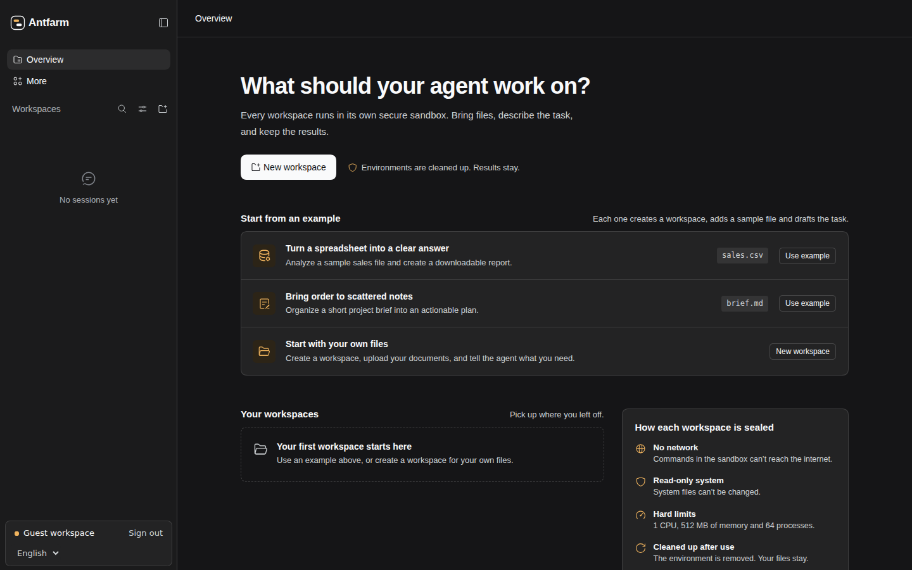

<div align="center">

# 🐜 Antfarm

**Let it dig. The glass holds**

A general-purpose agent for every task, built on Vultr secure sandboxes

Vultr Agent Rush Hackathon · Blast Radius Zero · Built on [DeepSeek Harness](https://github.com/deepseek-ai/deepseek-harness)

English | [中文](README.zh.md)

[**Try Antfarm**](#try-antfarm) · [Recorded demo](https://github.com/Agent-Rush-Team-A/Antfarm/pull/59) · [How it works](#how-it-works) · [Self-host](#quick-start)

[](https://github.com/Agent-Rush-Team-A/Antfarm/pull/59)

<sub>Real Vultr inference · Single-session Docker · Downloadable results · Accelerated playback</sub>

</div>

Give it files and a task. It runs commands and edits files inside a sealed sandbox, and the results stay in your workspace.

<a id="try-antfarm"></a>
## Try Antfarm

Open [**https://167.179.81.97/**](https://167.179.81.97/) and select **Try it as a guest**. No account or API key is needed; the guest workspace already has a Vultr inference model. You can switch between English and Chinese in the workbench.

Choose a starting point in the workbench.

- **Turn a spreadsheet into a clear answer** loads `sales.csv` for analysis.
- **Bring order to scattered notes** uses `brief.md` to draft a project plan.
- **Start with your own files** creates a workspace where you can upload documents and describe your task.

<details>
<summary>Optional walkthrough · Analyze the sample sales spreadsheet</summary>

1. Click **Use example** under **Turn a spreadsheet into a clear answer**. Antfarm prepares `sales.csv`, a single-session Docker workspace, and a task draft.
2. Send the draft. Watch the agent read the CSV, calculate revenue with Python, and verify the files it generates.
3. In **Workspace files**, click **Refresh**, then download `report.md` and `summary.csv`. Check the product revenues against the table below.
4. After the sandbox shows **Closed**, continue in the same conversation: “Use the existing results to write a three-bullet executive summary to `executive-summary.md`.” The next task starts a new container with the retained files.

| Product | Expected revenue |
| --- | ---: |
| Notebook | 324 |
| Desk lamp | 280 |
| Monitor stand | 210 |
| **Total** | **814** |

</details>

The recorded walkthrough uses single-session Docker. A single Antfarm deployment can offer Docker and Vultr VM workspace modes side by side. To enable VM modes, configure the Vultr VM backend in that deployment. The guest profile defaults to a two-hour sign-in, so download your results during your visit.

<details>
<summary>Workbench screenshot</summary>



</details>

## What Antfarm delivers

| Capability | What you can check |
| --- | --- |
| File-based tasks | Upload inputs, follow tool execution in the conversation, and download the generated files. |
| Workspace isolation | Each account owns its workspaces; tool execution uses the selected workspace environment. |
| Disposable execution, retained files | Single-session Docker closes automatically after work settles. Inputs and outputs remain available. |
| Continued work | Multi-session modes share an environment across conversations; VM workspace files remain on Vultr File System after closure. |

<a id="how-it-works"></a>
## How it works


The Harness checks account and workspace ownership, calls the model, and routes tool requests to the selected Docker or VM provider. Command output and exit status return to the conversation. The file service exposes inputs and results through the same workspace. A backend failure stops dependent execution.

The Docker profile limits each container to **1 CPU, 512 MiB of memory, and 64 processes**. It runs as a non-root user with a read-only root filesystem, no container network, and a writable mount for its assigned workspace. A separate Runner owns Docker access; Web communicates with the Runner over its management socket. See the [safety notes](SAFETY.md) for deployment assumptions and limits.

| Execution mode | Lifecycle | Files after closure |
| --- | --- | --- |
| Single-session Docker | Starts on demand; closes automatically after work settles | Persistent workspace directory |
| Multi-session Docker | Conversations share a container; manual or idle closure | Persistent workspace directory |
| Single-session Vultr VM | Creates a VM on demand; destroys it after work settles | Assigned directory on Vultr File System |
| Multi-session Vultr VM | Conversations share a VM; manual or idle closure destroys the instance | Assigned directory on Vultr File System; reopening mounts the same files |

Both VM modes mount their workspace on Vultr File System and create no disk snapshots. Files remain downloadable after closure; packages and other changes outside `/workspace` must be recreated in a new VM. The first conversation locks the workspace mode. See the [workspace execution design](team-docs/SANDBOX-DESIGN.md) for lifecycle and isolation details.

<a id="system-architecture-and-vultr-integration"></a>
## Vultr integration


| Vultr service | Role |
| --- | --- |
| Cloud Compute | Hosts the Web control plane; the VM provider manages separate execution instances through the Vultr API and reaches a verified helper over SSH. |
| Serverless Inference | Provides the agent model through the OpenAI-compatible endpoint. The guest demo uses `deepseek-v4.1-flash-1017`; inference credentials stay on the Harness side. |
| Vultr File System | Keeps workspace files for both VM modes independently of the execution instance. |

<a id="run"></a>

<a id="run-from-source"></a>

<a id="quick-start"></a>
## Self-host and reproduce

For the Docker demo, use Linux, Node.js **24.9.0 or newer**, pnpm **11.28.5**, Docker Engine, and a Vultr Serverless Inference key with chat completions access.

```sh
git clone https://github.com/Agent-Rush-Team-A/Antfarm.git
cd Antfarm
pnpm install
pnpm run build
```

<details>
<summary>Configure the Docker Runner and launch the guest workbench</summary>

1. Follow the [Runner setup guide](team-docs/SANDBOX-RUNNER.md) to start an independent Runner with a supervisor image pinned by digest and a non-root container identity. Web and Runner must share the same workspace root. Give Web access to the Runner management socket; give Docker Engine access only to Runner.
2. Save the [Docker modes configuration](docs/user/guide/workspace-sandboxes.md#docker-task-modes) as `/srv/antfarm-demo/docker-modes.json`. Adjust the paths to your deployment. Create `stateRoot` outside the workspace root, owned only by Web. Store the guest inference key in a private file owned by Web and outside every workspace mount.

```json
{
  "socketPath": "/run/agentrush-sandbox/runner.sock",
  "workspaceRoot": "/srv/antfarm-demo/workspaces",
  "stateRoot": "/srv/antfarm-demo/mode-state",
  "maxFiles": 2000,
  "maxBytes": 33554432
}
```

Set these paths to match your deployment, then launch Web from the repository root. The overlays enable accounts, Docker modes, and guest access in that order.

```sh
export DSH_HOME=/srv/antfarm-demo/web-data
export DSH_MULTIUSER_WORKSPACE_ROOT=/srv/antfarm-demo/workspaces
export DSH_DOCKER_MODES_CONFIG_JSON="$(cat /srv/antfarm-demo/docker-modes.json)"
export DSH_GUEST_INFERENCE_KEY_FILE=/srv/antfarm-demo/secrets/guest-inference.key

pnpm dsh web \
  --patch apps/cli/config/antfarm-web.patch.yml \
  --patch apps/cli/config/examples/harness-docker-modes.patch.yml \
  --patch apps/cli/config/examples/antfarm-guest-workbench.patch.yml \
  --host 127.0.0.1 --port 3088 --no-open
```

Open [http://127.0.0.1:3088/](http://127.0.0.1:3088/) and select **Try it as a guest**, then choose a [starting point](#try-antfarm). For public access, configure an [HTTPS reverse proxy](docs/user/guide/public-deployments.md).

</details>

For account provisioning and personal inference keys, see [multi-user setup](packages/api/multiuser/README.md#configuration) and [personal models](docs/user/guide/personal-models.md). For VM execution or all four workspace modes, follow the [Vultr VM deployment guide](docs/user/guide/workspace-vultr.md) and [VFS setup](team-docs/VULTR-VFS.md).

## Built on DeepSeek Harness

[DeepSeek Harness](https://github.com/deepseek-ai/deepseek-harness) supplies the agent loop, Web conversation interface, tool dispatch, and Cordis plugin architecture. Antfarm adds the multi-user and guest workbench, workspace file services, Docker and Vultr execution providers, environment lifecycle management, and Vultr inference credential routing. Project implementation and recorded evidence are available in the [Antfarm pull requests](https://github.com/Agent-Rush-Team-A/Antfarm/pulls?q=is%3Apr+is%3Amerged).

[MIT License](LICENSE) · [Third-party notices](THIRD_PARTY_NOTICES.md) · [Development](docs/development.md) · [Contributing](CONTRIBUTING.md) · [Hackathon](https://lablab.build/ai-hackathons/vultr-hackathon)
