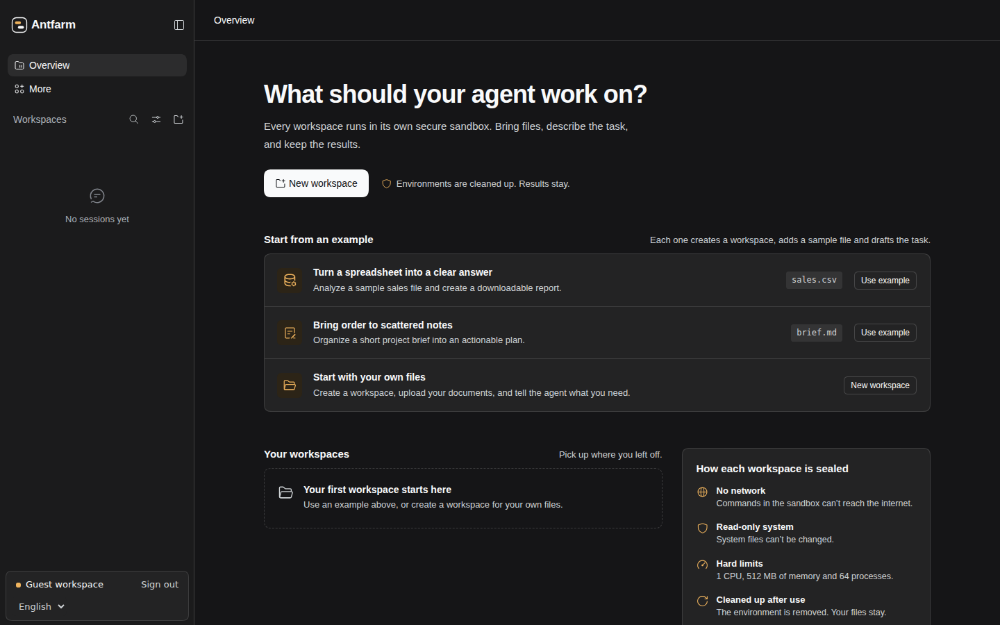

<div align="center">

# 🐜 Antfarm

**让它挖，玻璃会防住**

面向各种任务的通用 agent（智能体），基于 Vultr 安全沙箱构建。

Vultr Agent Rush Hackathon · Blast Radius Zero · 基于 [DeepSeek Harness](https://github.com/deepseek-ai/deepseek-harness)

[English](README.md) | 中文

[**体验 Antfarm**](#try-antfarm) · [演示录屏](https://github.com/Agent-Rush-Team-A/Antfarm/pull/59) · [工作原理](#how-it-works) · [验证证据](#verification) · [自行部署](#quick-start)

[](https://github.com/Agent-Rush-Team-A/Antfarm/pull/59)

<sub>真实 Vultr 推理 · 单会话 Docker · 可下载的成果文件 · 录屏已加速</sub>

</div>

把文件和任务交给它。它会在封闭的沙箱内运行命令、编辑文件，成果保留在你的工作区中。

<a id="try-antfarm"></a>
## 体验 Antfarm

打开 [**https://167.179.81.97/**](https://167.179.81.97/)，点击 **Try it as a guest**。无需账号或 API key，访客工作区已配置 Vultr 推理模型；进入后可切换中英文界面。

进入工作台后，可任选一种方式开始。

- **Turn a spreadsheet into a clear answer**（分析表格）会载入 `sales.csv`。
- **Bring order to scattered notes**（整理零散笔记）使用 `brief.md` 起草项目计划。
- **Start with your own files**（使用自己的文件）会创建工作区，可上传文档并描述任务。

<details>
<summary>可选演练 · 分析内置销售表格</summary>

1. 在 **Turn a spreadsheet into a clear answer** 下点击 **Use example**。Antfarm 会准备 `sales.csv`、单会话 Docker 工作区和任务草稿。
2. 发送草稿，观察 agent 读取 CSV、使用 Python 计算收入，并回读生成的文件进行检查。
3. 在 **Workspace files** 中点击 **Refresh**，再下载 `report.md` 和 `summary.csv`，对照下表核验各产品收入。
4. 沙箱显示 **Closed** 后，在同一对话中继续：“根据现有结果，将三条要点的管理层摘要写入 `executive-summary.md`。”新任务会启动新容器，并使用保留的文件。

| 产品 | 预期收入 |
| --- | ---: |
| Notebook | 324 |
| Desk lamp | 280 |
| Monitor stand | 210 |
| **合计** | **814** |

</details>

录屏中的演练使用单会话 Docker。同一套 Antfarm 部署可以同时提供 Docker 和 Vultr VM 工作区模式。启用 VM 模式时，需要在该部署中额外配置 Vultr VM 后端。访客登录默认有效两小时，请在访问期间下载成果。

<details>
<summary>工作台截图</summary>



</details>

## Antfarm 能交付什么

| 能力 | 可直接检查的表现 |
| --- | --- |
| 基于文件完成任务 | 上传输入，在对话中查看工具执行过程，下载生成的成果。 |
| 工作区隔离 | 每个账号拥有自己的工作区，工具在所选工作区的执行环境中运行。 |
| 自动回收环境、保留文件 | 单会话 Docker 在任务结束后自动关闭，输入和输出文件仍可访问。 |
| 持续迭代 | 多会话模式在不同对话间共享执行环境；VM 关闭后，工作区文件仍保留在 Vultr File System。 |

<a id="verification"></a>
## 验证与证据

演示使用真实模型调用和执行后端。以下记录来自不同环境；云端验收记录与公网 Docker Demo 分别验证。

| 证据 | 验证内容 |
| --- | --- |
| [访客演示 · PR #59](https://github.com/Agent-Rush-Team-A/Antfarm/pull/59) | 访客通过 Vultr Serverless Inference 和单会话 Docker 执行任务、下载结果，并在容器回收后继续访问文件。 |
| [云端表格验收 · PR #39](https://github.com/Agent-Rush-Team-A/Antfarm/pull/39) | 较早的一次完整运行使用真实 Vultr 推理和工作区 VM，得到 **9 笔订单、16 件净销量、1,719.50 净销售额**，并检查了工作区隔离和文件保留。 |
| [超时清理 · PR #39](https://github.com/Agent-Rush-Team-A/Antfarm/pull/39) | 后续专项检查通过独立 SSH 检查确认：Bash 触发 1,000 ms 超时后，Shell 和子进程均已终止。 |

[云端验收样例](apps/web/tests/fixtures/workspace-spreadsheet/README.zh.md)包含 CSV 输入、独立计算的预期结果与复现说明。运行该场景会创建付费 Vultr 资源。


<a id="how-it-works"></a>
## 工作原理


Harness 检查账号与工作区归属、调用模型，并将工具请求交给选定的 Docker 或 VM provider。命令输出和退出状态返回对话；文件服务在同一工作区中提供输入与成果。后端失败时，依赖它的执行会停止。

Docker profile 将每个容器限制为 **1 CPU、512 MiB 内存、64 个进程**，使用非 root 用户、只读根文件系统、关闭容器网络，并为所属工作区挂载可写目录。独立 Runner 持有 Docker 访问权限，Web 通过管理 socket 与 Runner 通信。部署前提与限制见[安全说明](SAFETY.zh.md)。

| 执行模式 | 生命周期 | 关闭后的文件 |
| --- | --- | --- |
| 单会话 Docker | 按需启动，任务结束后自动关闭 | 保留在持久化工作区目录 |
| 多会话 Docker | 多个对话共享容器，手动或空闲关闭 | 保留在持久化工作区目录 |
| 单会话 Vultr VM | 按需创建 VM，任务结束后销毁 | 保留在 Vultr File System 的所属目录 |
| 多会话 Vultr VM | 多个对话共享 VM，手动或空闲关闭时销毁实例 | 保留在 Vultr File System 的所属目录，重开时挂载同一批文件 |

两种 VM 模式都将工作区挂载到 Vultr File System，不创建磁盘快照。关闭后文件仍可下载；`/workspace` 之外安装的软件包和其他修改需要在新 VM 中重新配置。首次创建对话后，工作区模式便锁定。生命周期与隔离细节见[工作区执行设计](team-docs/SANDBOX-DESIGN.md)。

<a id="system-architecture-and-vultr-integration"></a>
## Vultr 集成


| Vultr 服务 | 用途 |
| --- | --- |
| Cloud Compute | 承载 Web 控制服务；VM provider 通过 Vultr API 管理独立执行实例，通过 SSH 连接经校验的 helper。 |
| Serverless Inference | 通过兼容 OpenAI 的接口提供 agent 模型。访客 Demo 使用 `deepseek-v4.1-flash-1017`，推理凭证保留在 Harness 侧。 |
| Vultr File System | 独立于执行实例，保留两种 VM 模式的工作区文件。 |

<a id="run"></a>

<a id="run-from-source"></a>

<a id="quick-start"></a>
## 自行部署与复现

复现 Docker Demo 需要 Linux、Node.js **24.9.0 或更新版本**、pnpm **11.28.5**、Docker Engine，以及可调用 Chat Completions 的 Vultr Serverless Inference API key。

```sh
git clone https://github.com/Agent-Rush-Team-A/Antfarm.git
cd Antfarm
pnpm install
pnpm run build
```

<details>
<summary>配置 Docker Runner 并启动访客工作台</summary>

1. 按 [Runner 部署指南](team-docs/SANDBOX-RUNNER.md)启动独立 Runner，使用固定镜像摘要的监管镜像和非 root 容器身份。Web 与 Runner 必须使用同一工作区根目录；Web 只需访问 Runner 管理 socket，Docker Engine 访问权限只授予 Runner。
2. 将 [Docker 模式配置](docs/user/guide/workspace-sandboxes.zh.md#docker-task-modes)保存为 `/srv/antfarm-demo/docker-modes.json`，按实际部署调整路径。在工作区根目录之外创建仅由 Web 账号持有的 `stateRoot`。访客推理 key 也需保存为 Web 账号持有的私有文件，放在所有工作区挂载之外。

```json
{
  "socketPath": "/run/agentrush-sandbox/runner.sock",
  "workspaceRoot": "/srv/antfarm-demo/workspaces",
  "stateRoot": "/srv/antfarm-demo/mode-state",
  "maxFiles": 2000,
  "maxBytes": 33554432
}
```

按部署设置以下路径，再从仓库根目录启动 Web。这三个 overlay 依次启用账号、Docker 模式和访客访问。

```sh
export DSH_HOME=/srv/antfarm-demo/web-data
export DSH_MULTIUSER_WORKSPACE_ROOT=/srv/antfarm-demo/workspaces
export DSH_DOCKER_MODES_CONFIG_JSON="$(cat /srv/antfarm-demo/docker-modes.json)"
export DSH_GUEST_INFERENCE_KEY_FILE=/srv/antfarm-demo/secrets/guest-inference.key

pnpm dsh web \
  --patch apps/cli/config/antfarm-web.patch.yml \
  --patch apps/cli/config/examples/harness-docker-modes.patch.yml \
  --patch apps/cli/config/examples/antfarm-guest-workbench.patch.yml \
  --host 127.0.0.1 --port 3088 --no-open
```

打开 [http://127.0.0.1:3088/](http://127.0.0.1:3088/)，点击 **Try it as a guest**，再选一种[开始方式](#try-antfarm)。公网访问需配置 [HTTPS 反向代理](docs/user/guide/public-deployments.zh.md)。

</details>

账号配置与个人推理 key 见[多用户配置](packages/api/multiuser/README.zh.md#configuration)和[个人模型](docs/user/guide/personal-models.zh.md)。VM 执行或四种工作区模式的组合部署见 [Vultr VM 部署指南](docs/user/guide/workspace-vultr.zh.md)与 [VFS 配置](team-docs/VULTR-VFS.md)。

## 基于 DeepSeek Harness

[DeepSeek Harness](https://github.com/deepseek-ai/deepseek-harness)提供 agent loop、Web 对话界面、工具调度和 Cordis 插件架构。Antfarm 在此基础上增加多用户与访客工作台、工作区文件服务、Docker 与 Vultr 执行 provider、环境生命周期管理，以及 Vultr 推理凭证路由。实现与演示证据见 [Antfarm 合并的 PR](https://github.com/Agent-Rush-Team-A/Antfarm/pulls?q=is%3Apr+is%3Amerged)。

[MIT 许可证](LICENSE) · [第三方声明](THIRD_PARTY_NOTICES.md) · [开发指南](docs/development.zh.md) · [贡献指南](CONTRIBUTING.zh.md) · [比赛主页](https://lablab.build/ai-hackathons/vultr-hackathon)
