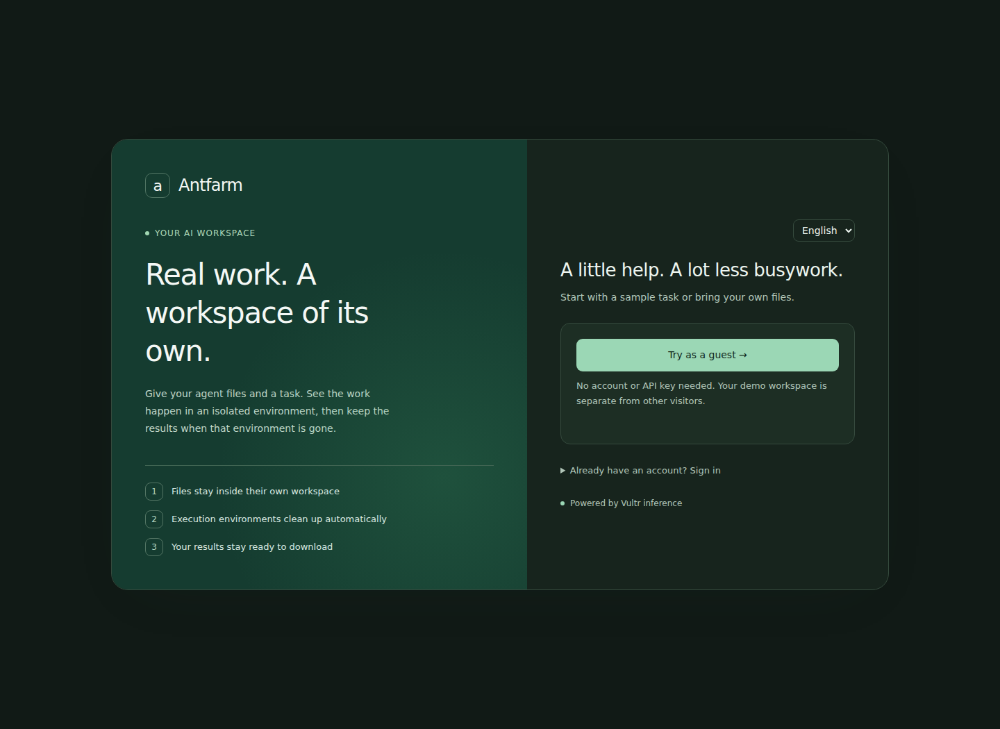
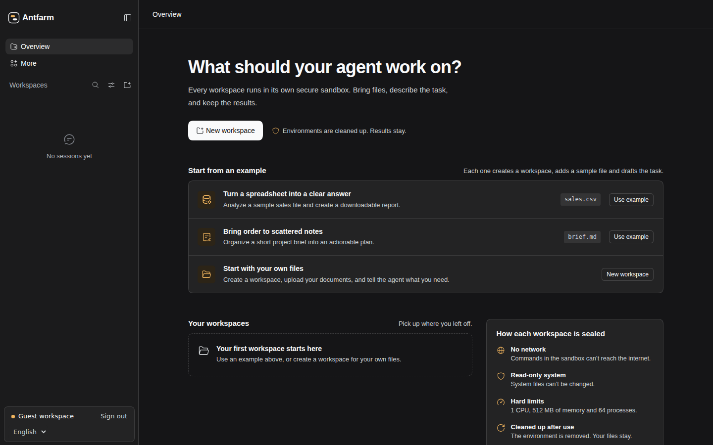

# Antfarm guest workbench

English | [中文](antfarm-guest-workbench.zh.md)

## Prepare the preview

Use this optional workbench for reviewers who need to try Antfarm without an account or model key. Visitors can start a sample task, upload their own files, watch the execution environment, and download retained results. English is the initial language; the language setting also supports Chinese and remembers the browser's explicit choice.

Start from a Linux Antfarm checkout with built artifacts and an independent Docker Runner. Follow [workspace sandbox management](workspace-sandboxes.md#docker-task-modes) to configure the Runner socket, the canonical workspace root, and the private Docker mode state directory. Use independent preview storage and a unique Runner deployment identifier when an existing service is already running.

Provision a valid Vultr inference key in a private file owned by the Web service account. Keep the file outside the workspace root and all container mounts. Set `DSH_GUEST_INFERENCE_KEY_FILE` to its absolute path; the overlay fails when this environment variable is missing. The key value stays on the Host and must not be placed in the overlay or browser configuration. The existing Antfarm Web overlay supplies the Vultr catalog and inference binding.

## Enable the workbench

From the checkout root, inspect the profile with the account, Docker mode, and workbench overlays in this order:

```sh
export DSH_GUEST_INFERENCE_KEY_FILE=/srv/antfarm-demo/secrets/guest-inference.key
pnpm dsh web --patch apps/cli/config/antfarm-web.patch.yml --patch apps/cli/config/examples/harness-docker-modes.patch.yml --patch apps/cli/config/examples/antfarm-guest-workbench.patch.yml --dump-config
```

The [workbench overlay](../../../apps/cli/config/examples/antfarm-guest-workbench.patch.yml) enables visitor access, the Antfarm palette, and one validated Web bootstrap for the workspace dashboard and right file panel. Its literal module name `./antfarm-workbench-boot.mjs` resolves beside the overlay, so profile storage does not determine its location. Its presentation settings are `workbench: true`, `initiallyExpanded: true`, and `defaultPage: workspace-files`. Saved panel layouts remain authoritative; a fresh desktop Session opens the file panel, while narrow screens keep it collapsed. The Antfarm Web overlay omits the Harness plugin customization menus, including **More** in the left sidebar.

Launch the same profile after the Runner and private deployment settings are ready:

```sh
pnpm dsh web --patch apps/cli/config/antfarm-web.patch.yml --patch apps/cli/config/examples/harness-docker-modes.patch.yml --patch apps/cli/config/examples/antfarm-guest-workbench.patch.yml --no-open
```

Choose the Web port and listener through the existing deployment configuration. The workbench overlay does not select a port, publish a service, or replace an existing deployment. The configured model key, Docker socket permissions, and independent Runner must be verified in the target environment before inviting reviewers.

## Try a task

Open the preview and choose **Try it as a guest**. The application creates a separate visitor identity with an HttpOnly login cookie. Every visitor owns only their own workspaces and conversations; the browser does not ask visitors for a password or model key.

In the expanded sidebar, the account card groups the account name, **Sign out**, and the language setting. Signed-in team members can open **My credentials** above the card.

Choose the sales example to prepare `sales.csv` and a task draft, then send the task. The agent produces a Markdown report and CSV summary. The file panel shows uploaded files and generated results. Download a result after the task finishes, then continue the conversation to use the retained files in a fresh environment. Choose the project brief example for a plan, or create a workspace to upload your own files.

The visitor overlay permits at most 100 non-disabled visitor accounts and gives new visitor logins a 120-minute lifetime. An authenticated visitor who retries guest entry retains the same identity and expiry. At capacity, the application asks the visitor to contact the demo team. An operator can raise the limit or disable visitor accounts through `MultiuserService.disableUser()` while preserving file ownership; logout and expiry alone do not free capacity. A visitor cannot configure personal model credentials or delete a workspace.

## Recover from a failed action

An interrupted upload shows a localized connection message and keeps the previous file listing. Check the connection and retry the upload. A refused file also leaves the listing intact; refresh it to inspect existing names before selecting another file. Execution preparation failures appear through the workspace environment controls; use [sandbox recovery guidance](workspace-sandboxes.md#use-the-web-controls) before retrying a task.

## Preview the interface

The login page and workbench use the same theme preference. These screenshots show the English interface with system dark mode.




