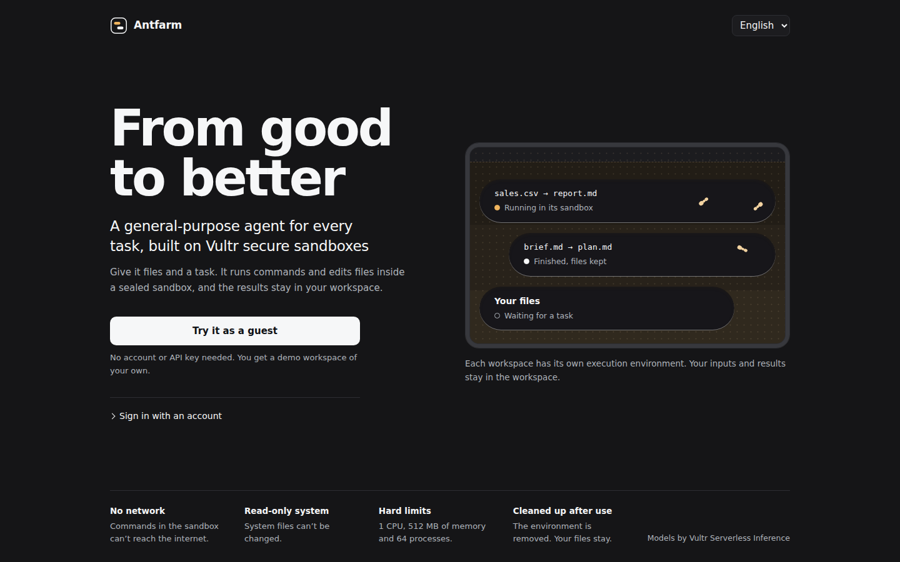
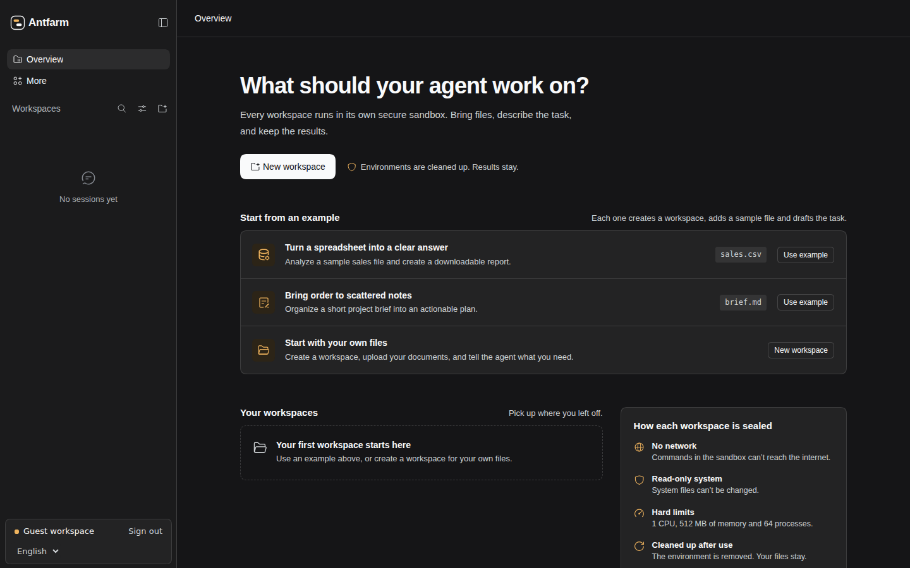

# Antfarm 游客工作台

[English](antfarm-guest-workbench.md) | 中文

## 准备预览

使用这个可选工作台，让评审无需账号或模型密钥即可体验 Antfarm。游客可以启动示例任务、上传自己的文件、查看执行环境，并下载保留的成果。初始语言为英文；语言设置同时支持中文，并记住当前浏览器明确选择的语言。

从已经构建产物、配有独立 Docker Runner 的 Linux Antfarm checkout 开始。按照[工作区沙箱管理](workspace-sandboxes.zh.md#docker-task-modes)配置 Runner socket、规范工作区根目录和私有 Docker 模式状态目录。现有服务已经运行时，使用独立的预览存储和唯一的 Runner 部署标识。

将有效的 Vultr 推理密钥放在 Web 服务账号持有的私有文件中。密钥文件必须位于工作区根目录和所有容器挂载之外。将 `DSH_GUEST_INFERENCE_KEY_FILE` 设置为它的绝对路径；缺少此环境变量时，叠加层会报错。密钥值保留在 Host，禁止放入叠加层或浏览器配置。现有 Antfarm Web 叠加层提供 Vultr 模型目录和推理绑定。

## 启用工作台

在 checkout 根目录中，依次加载账号、Docker 模式和工作台叠加层，检查 profile 配置：

```sh
export DSH_GUEST_INFERENCE_KEY_FILE=/srv/antfarm-demo/secrets/guest-inference.key
pnpm dsh web --patch apps/cli/config/antfarm-web.patch.yml --patch apps/cli/config/examples/harness-docker-modes.patch.yml --patch apps/cli/config/examples/antfarm-guest-workbench.patch.yml --dump-config
```

[工作台叠加层](../../../apps/cli/config/examples/antfarm-guest-workbench.patch.yml)启用游客访问、Antfarm 配色，以及为工作区首页和右侧文件面板提供设置的单个已验证 Web bootstrap。模块名使用字面值 `./antfarm-workbench-boot.mjs`，以叠加层所在目录为基准解析，位置不受 profile 存储目录影响。界面设置为 `workbench: true`、`initiallyExpanded: true` 和 `defaultPage: workspace-files`。已有面板布局优先保留；新的桌面 Session 会打开文件面板，窄屏则保持折叠。

Runner 和私有部署设置准备好后，启动同一个 profile：

```sh
pnpm dsh web --patch apps/cli/config/antfarm-web.patch.yml --patch apps/cli/config/examples/harness-docker-modes.patch.yml --patch apps/cli/config/examples/antfarm-guest-workbench.patch.yml --no-open
```

通过现有部署配置选择 Web 端口和监听地址。工作台叠加层不选择端口、不发布服务，也不替换已有部署。邀请评审前，必须在目标环境验证模型密钥、Docker socket 权限和独立 Runner。

## 体验任务

打开预览，选择 **Try it as a guest**（中文界面为 **游客体验**）。应用会创建独立的游客身份，并签发 HttpOnly 登录 Cookie。每个游客只拥有自己的工作区和对话；浏览器不会要求游客输入密码或模型密钥。

选择销售示例，准备 `sales.csv` 和任务草稿，然后发送任务。Agent 会生成 Markdown 报告和 CSV 汇总。文件面板显示上传文件和生成成果。任务完成后下载成果，再继续对话，在新的执行环境中使用保留文件。选择项目简报示例可生成计划，也可以创建工作区并上传自己的文件。

游客叠加层最多允许 100 个未禁用游客账号，新游客登录的有效期为 120 分钟。已登录游客重试游客入口时，会保留原身份和过期时间。达到容量上限时，应用会提示游客联系演示团队。运维人员可以提高上限，或通过 `MultiuserService.disableUser()` 禁用游客账号并保留文件归属；退出和登录过期本身不会释放容量。游客不能配置个人模型凭证或删除工作区。

## 处理失败的操作

上传中断时会显示本地化连接提示，并保留原文件列表。检查连接后重试上传。文件被拒绝时也会保留列表；选择其他文件前，刷新列表以检查现有文件名。执行准备失败会通过工作区环境控件显示；重试任务前，按照[沙箱恢复指南](workspace-sandboxes.zh.md#use-the-web-controls)处理。

## 预览界面

登录页与工作台使用同一主题偏好。以下截图展示英文界面在系统深色模式下的表现。




